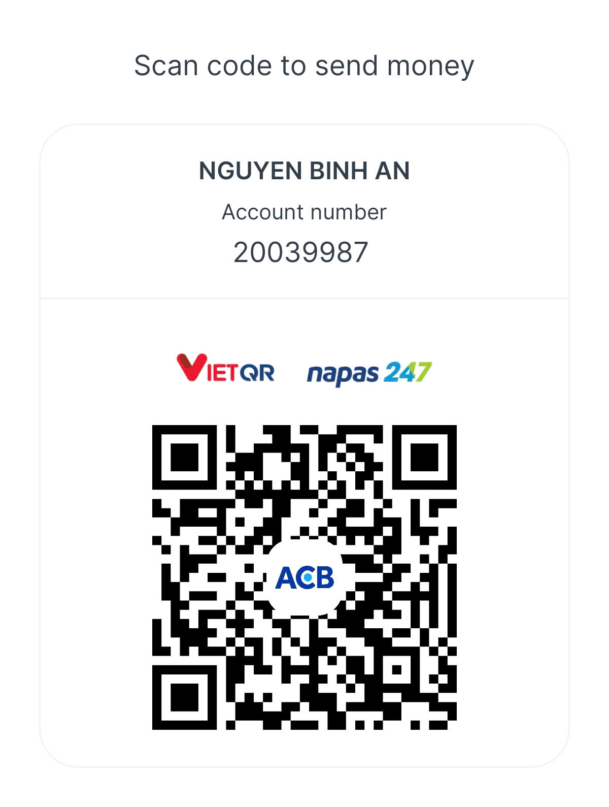

[🇻🇳 Tiếng Việt](README.md) | 🇬🇧 English

# GMS Fix

An Android app that keeps **notifications (FCM) from being blocked by HyperOS**: no lost messages, no delays, no dropped connections. Built for Xiaomi phones running **HyperOS CN ROM** with **no root**.

- Package: `com.anb.gmsfix` · versionName 3.0.x · minSdk 24 · targetSdk 35
- Test phone: Xiaomi `popsicle` (2509FPN0BC), HyperOS OS4.0 CN, Android 17, no root
- Constraint: in daily use **Developer options must stay off** (so banking apps and VNeID work). Shizuku is only turned on when you press **Fix now**.
- Language: the app supports **Tiếng Việt / English / follow system**; pick the language in the app.

> ☕ Did the app help you? [Buy me a coffee](#-buy-me-a-coffee)!

---

## Setup (first time on a new phone)

Do this once. Afterwards Developer options can be turned off again and the app keeps working.

**1. Install the app**
Download `GmsFix-3.0.3.apk` from [Releases](https://github.com/justBA/GmsFix/releases/latest) and install it. On first launch, allow **Notifications** (needed for lost/delayed message alerts).

**2. Enable Developer options**
*Settings → About phone* → tap **OS version** 7 times. Then go to *Settings → Additional settings → Developer options* and enable:
- **USB debugging**
- **Install via USB**
- **USB debugging (Security settings)**: Xiaomi requires this before `WRITE_SECURE_SETTINGS` can be granted. It usually requires a signed-in Mi account and a SIM card.
- **Wireless debugging**, if you use Shizuku without a computer.

**3. Install and start Shizuku**
- Download Shizuku from [GitHub](https://github.com/RikkaApps/Shizuku/releases) (the test phone uses 13.6.0).
- **Pair Shizuku via Wireless debugging (once, no computer needed):**
  1. Connect to **Wi-Fi** (any network, internet not required).
  2. Allow Shizuku's **notifications**: the pairing code is typed right into its notification.
  3. *Settings → Additional settings → Developer options* → turn on **Wireless debugging**. When asked "Allow wireless debugging on this network?", choose **Allow** (tick "Always allow on this network" so it won't ask again).
  4. Open Shizuku → *Start via Wireless debugging* → tap **Pairing**. Shizuku shows a notification "Searching for pairing service…".
  5. Go back to *Wireless debugging* → tap **Pair device with pairing code**. A **6-digit code** appears. Keep this dialog open.
  6. Pull down the notification shade → Shizuku's notification → **Enter pairing code** → type the 6 digits → send. "Pairing successful" means done. A "Shizuku" entry appears under *Paired devices* in *Wireless debugging*.
  7. Back in Shizuku → tap **Start**. The status changes to *Shizuku is running*.
  - No notification to type the code into: check Shizuku's notification permission, or use split screen (Shizuku + Settings) and redo steps 4–6.
  - **No need to pair again** afterwards: just have Wi-Fi + Wireless debugging on and tap Start. GMS Fix turns Wireless debugging on and opens Shizuku when you press Fix now.
- With a computer, you can start Shizuku over a cable instead, running the command Shizuku shows under *Start via adb*, for example:
  ```bash
  adb shell 'sh -c "$(pm path moe.shizuku.privileged.api | cut -d: -f2 | sed s/base.apk//)lib/arm64/libshizuku.so"'
  ```
- **Wireless debugging can only be enabled while the phone is connected to Wi-Fi** (no internet needed). Without Wi-Fi, connect to a hotspot from another phone, or use a cable + the adb command above. Once Shizuku is running, disconnecting Wi-Fi is fine. Fix now warns you if Wi-Fi is missing instead of getting stuck at opening Shizuku.
- Shizuku **stops** after a reboot or when Wireless debugging / Developer options are turned off. Next time you press Fix, the app turns Developer options on and opens Shizuku so you can tap Start, then continues by itself.

**4. Press *Fix now* in GMS Fix**
- Tap the **ⓘ next to Status** to see the requirements checklist (required apps, Shizuku, each GMS Fix permission). Unmet items show a ! — tap it for a guide and a button that opens the right settings page / asks for the permission / opens the download page. *Fix now* only runs when the required items are met; otherwise it guides you to the missing one instead of failing midway.
- Shizuku asks for permission for GMS Fix → **Allow**. On HyperOS 4 CN, Shizuku does not keep "Allow all the time", so you may have to tap Allow on every Fix.
- Fix's *Grant permissions to GMS Fix* step grants the following automatically. Without Shizuku you can run them with adb from a computer:
  ```bash
  adb shell pm grant com.anb.gmsfix android.permission.WRITE_SECURE_SETTINGS
  adb shell pm grant com.anb.gmsfix android.permission.DUMP
  adb shell pm grant com.anb.gmsfix android.permission.PACKAGE_USAGE_STATS
  adb shell cmd appops set com.anb.gmsfix GET_USAGE_STATS allow
  adb shell cmd appops set com.anb.gmsfix SCHEDULE_EXACT_ALARM allow
  ```
  | Permission | Used for |
  |---|---|
  | `WRITE_SECURE_SETTINGS` | Writing `aurogon_enable`, `device_idle_constants`, Nighttime mode; turning Developer options on/off by itself |
  | `DUMP` | Reading FCM, Greezer and doze state; re-applying the Greezer part after a reboot |
  | `PACKAGE_USAGE_STATS` + `GET_USAGE_STATS` | Reading `dumpsys GcmService` without Shizuku |
  | `SCHEDULE_EXACT_ALARM` | Exact "Wake GMS" alarms |

**5. HyperOS permissions for GMS Fix itself**
- *Settings → Apps → GMS Fix → Other permissions* → enable **Read installed apps list**. The app also asks when you open the app picker. Without it the list only shows system apps.
- Enable **Autostart** and set the battery setting to **No restrictions** for GMS Fix.

**6. Pick apps and good habits**
- Add your chat apps, banking apps… to the list, then press **Fix now** again.
- **Lock** important apps in Recents (long-press the card → lock). Don't swipe them away or use "clear all": on this ROM that is a force-stop.
- Nighttime mode: the app turns it off by itself (*Night* option, on by default).

**7. Turn Developer options off again**
Use the button in the app when you're done (by default the app turns it off after Fix), so banking apps and VNeID work.

With Developer options off and Shizuku not running, these **still work**: periodic GMS wake-up, `aurogon_enable` (FCM thaws apps), relaxed deep doze, keeping Nighttime mode off, alerts, re-applying after reboot. **Needs Shizuku (press Fix):** No Restrictions for Google Play services after a reboot, the night alarm list, clearing the stopped state, autostart, Doze whitelist.

---

## Why notifications get lost or delayed on HyperOS CN

| Cause | Effect |
|---|---|
| **Greezer** (the freezer in `miui-services`) freezes background apps, and freezes GMS too (GMS is hardcoded in `greezer_power_black_list`) | FCM connection lost, messages to apps held back |
| **Sleep mode / Nighttime mode** at night (~01:00–05:30, when it detects you're asleep): PowerKeeper **turns off 4G + Wi‑Fi** and Greezer freezes even apps in No Restrictions | FCM disconnected for hours, messages arrive in a burst in the morning. **Solved:** turn off *Battery → Additional features → Nighttime mode* (the app's *Night* option keeps it off). Once it's off Greezer no longer enters sleep mode either, **no root needed** |
| **Very aggressive deep doze**: screen off means Quick Doze, deep idle after ~1 minute, maintenance windows every 1 → 6 hours | Normal-priority messages held by the server for up to 1–6 hours |
| **Swiping an app out of Recents = force-stop** (`SwipeUpClean`, `OneKeyClean`, `GameClean`) | The app is fully stopped and GMS drops its messages (`Failed to broadcast to stopped app`) until the app is opened again |
| **PowerKeeper** overwrites `MILLET_NO_RESTRICT_APP` from its battery settings on every reboot or battery-mode change | Settings written by command are lost |
| ROM flag `cn.google.services` | GMS disables some features: Maps Timeline, Quick Share, offline Find Hub, location sharing… Not fixable without root |

---

## Features

The home screen offers 2 approaches, each on its own screen. **Only approach 1 works for now**; approach 2 (theme) does not work yet.

### 1. Keep FCM alive (daily use)

**App list, in 2 tiers** (tap ⚡ to change tier; this opens the selected app's *Battery details* page directly):

| | Orange ⚡ **Always in background** | Grey ⚡ **Only on message** (default) |
|---|---|---|
| Examples | Google Play services, Zepp (watch) | Facebook, Messenger, Zalo, MoMo, banks… |
| Battery setting (PowerKeeper) | **No restrictions** | **Battery saver (recommended)** |
| Frozen by Greezer when idle | No | Yes (saves battery) |
| Thawed on FCM message | ✅ | ✅ |
| Autostart, clear stopped state, run in background, background data | ✅ | ✅ |
| Doze exemption, low-latency, "active" standby bucket | ✅ | ❌ (Android still briefly wakes the app for high-priority messages) |

**Options:**
- **Wake GMS periodically** (5/10/15/20 minutes): only runs on battery with the screen off. The app queries a GMS provider so Greezer thaws GMS, re-checks the FCM connection, and retries after 3 minutes if it's broken.
- **Let FCM thaw frozen apps** (on by default): writes `broadcastctrl:true#pkg/com.google.android.c2dm.intent.RECEIVE#…` to Settings.Global `aurogon_enable`. Greezer only thaws an app when an FCM message arrives. An "every broadcast" mode (`broadcastctrl:false`) also exists but uses more battery.
  - **Rewrite if changed**: if the cloud config or HyperOS changes it back, the app rewrites it.
  - **All apps with FCM** (on by default): besides the selected list, adds every app with a c2dm receiver. Newly installed apps are added automatically. Tap "view ›" to see the list.
- **Relax deep doze** (on by default): Settings.Global `device_idle_constants`. Deep idle after 2 minutes, maintenance every 15 → 30 minutes. Normal-priority messages are delayed at most ~30 minutes instead of 1–6 hours. The ⓘ button shows the values in use and HyperOS's defaults.
- **Night (sleep mode)** (on by default, verified on the night of 24→25/11):
  - Turns off **Nighttime mode**: Settings.Secure `sec_pc_config_scenario_policies_open = 0`. The app writes it with its own permission (**no Shizuku needed**) and turns it off again on every GMS wake-up or boot if it was turned back on.
  - Adds Google Play services + GMS Fix to `cloud_aurogon_alarm_allow_list`, so heartbeat/wake-up alarms get through while frozen. This part needs Shizuku. The settings check reports it if it gets reset.

**Alerts** (each type can be turned on/off; applies to apps in the list and all apps with FCM):
- **Lost notification**: GMS dropped a message because the app is stopped.
- **Delayed notification**: a high-priority message delayed more than 2 minutes. Normal-priority messages are only logged when delayed more than 35 minutes.
- **Settings changed**: HyperOS reverted background permissions.
- **App notifications off** (off by default).
- A separate **Log** page, filterable by type, with app names.

**Status:** FCM connection, 24-hour stats, settings check, Shizuku, root, Developer options. A widget shows FCM status.
- **FCM last 24 hours** is shown as `Drops 10 (2 long) • delays 22 (0 worrying)`. The first number comes from GMS and counts Wi‑Fi ↔ 4G switches (0-second drops) and high-priority messages delayed 1–2 seconds, so it's always larger than the alert log. In parentheses is what matters: drops over 1 minute, high-priority messages delayed over 2 minutes, normal messages delayed over 35 minutes. The coloured label on the right is based on that.
- The **alert log** uses the phone's local time. Times in GMS diagnostics are UTC; the app converts them.

**Fix now** (needs Shizuku or root). Steps:
1. No Restrictions by tier
2. Disable Greezer's GMS freezer (`dumpsys greezer IM GMS disable`) and the LM allowlist
3. Low-latency
4. Doze whitelist (added for always-on apps, removed for on-message apps)
5. Allow running in background
6. Background data
7. Standby bucket
8. Autostart (MIUI appop 10008 + 10053, the switch)
9. Grant permissions to GMS Fix (`WRITE_SECURE_SETTINGS`, `DUMP`, usage access, exact alarm)
10. **Clear stopped state** for apps in the list and all apps with FCM
11. Night (sleep mode), if enabled
12. Verify

When done, the app turns Developer options off, if that option is on.

**After a reboot:** the app re-applies the Greezer part (with the `DUMP` permission), `aurogon_enable`, doze, and turns Nighttime mode off, **no Shizuku needed**. Only Google Play services gets removed from No Restrictions by PowerKeeper, so the app reminds you to press Fix.

### 2. Theme-based tweak — ⚠️ NOT WORKING YET

Creates a hidden `.mtz` file (`Download/GmsFix-FCM.mtz`) that overrides `theme_values.xml` of `android.miui`: removes GMS from Greezer's blacklist and adds apps to whitelists. Includes a button to remove or restore the Themes app (optional, with rollback).

**Not working yet — don't rely on it instead of section 1.** Reason: the Themes app (both CN 11.5.6 and Global) checks DRM when applying (`DRM_ERROR_RIGHT_FILE_NOT_EXISTS`). This project does **not** bypass DRM.

---

## Verified on the device

- `MILLET_NO_RESTRICT_APP` (Settings.System) is **only a copy** of PowerKeeper's battery settings. Normal apps can't write this key ("You cannot keep your settings in the secure settings"); a shell is required.
- PowerKeeper's data is protected by a `signature|privileged` permission and can't be read. The *Battery details* page can be opened with `android.settings.REQUEST_IGNORE_BATTERY_OPTIMIZATIONS` + `package:<pkg>`.
- `device_config put device_idle …` is blocked by Android 17, even for shell. Settings.Global `device_idle_constants` **can be written with the app's permission**, but the app can't read it back, so it checks values via `dumpsys deviceidle`.
- Quick Doze ignores `inactive_to` and motion. `quick_doze_delay_to` works but is capped at ~2 minutes. `idle_to`/`max_idle_to` work.
- Shizuku 13.6 on this ROM **doesn't save** "Allow all the time", so you may have to tap Allow on every Fix.
- Autostart does **not** rescue an app that has been fully stopped, because GMS drops the message first. It only matters for apps whose process was killed without a force-stop.
- MIUI appop `10053` is the state of the Autostart switch. Fix sets it together with `10008`. Before the fix, 24 apps were out of sync (10008 allowed, 10053 blocked).
- The phone's exit-info: **SwipeUpClean 202, OneKeyClean 145, GameClean 108** force-stops. Swiping an app away, "clear all" and Game Turbo all really force-stop.
- Sleep mode on the night of 23→24/11: `SLEEP_MODE enter/exit` (01:15–03:54, 04:15–05:30) **matches exactly** GMS `ERR_NET_DOWN`. Cause: **PowerKeeper turns off mobile data** (`Set user data enabled to false … callingPackage=com.miui.powerkeeper`) **and turns off Wi‑Fi** (`CMD_WIFI_TOGGLED`, WorkSource `com.miui.powerkeeper`), then turns them back on when leaving sleep mode. The UI option: *Battery → Additional features → Nighttime mode* = Settings.Secure `sec_pc_config_scenario_policies_open`. Sleep mode also freezes GMS Fix itself, so "Wake GMS" barely ran all night.
- `cloud_sleepmode_networkpolicy_enabled` is **not** what cuts the network. According to the ROM code (`MiuiNetworkPolicyManagerService.sleepModeEnableControl`), that branch is only enabled when the value is `"on"` **and** `key_open_earthquake_warning == 1`, which is 0 on the phone. The `mSleepModeWhitelistUids` list (added via `IMiuiNetworkManager.onSleepModeWhitelistChange`, transaction code 5) belongs to this branch, so it has no effect either.
- Heartbeat broadcasts (`GTALK_HEARTBEAT`, `MCS_HEARTBEAT`) are **unreliable**: once it coincided with a heartbeat, 3 retries had no effect. Not used.
- Chat app messages updated silently (Zalo merges messages within ~10 seconds, KChat `onlyAlertOnce`, Instagram `groupAlertBehavior=SUMMARY`) are caused by the apps, not the phone.

---

### Checking night network loss on another phone

The next morning, connect adb and run:

```bash
# Did PowerKeeper turn off Wi‑Fi (line CMD_WIFI_TOGGLED ... WorkSource{1000 com.miui.powerkeeper})
adb shell dumpsys wifi | grep -E "CMD_WIFI_TOGGLED.*powerkeeper"
# Did PowerKeeper turn off mobile data
adb shell dumpsys activity service com.android.phone | grep -E "user data enabled.*powerkeeper"
# Greezer sleep mode enter/exit times
adb shell dumpsys greezer | grep "SLEEP_MODE"
# When and how long GMS lost the network
adb shell dumpsys activity service com.google.android.gms/.gcm.GcmService | grep -A2 "INCIDENT"
# Is Nighttime mode on (1) or off (0)
adb shell settings get secure sec_pc_config_scenario_policies_open
```

If the times Wi‑Fi/4G were turned off match `SLEEP_MODE: enter` and GMS reports `ERR_NET_DOWN`, it's Nighttime mode.

---

## Experiments

| Experiment | What was done | Results so far | Status |
|---|---|---|---|
| **GMS + GMS Fix in `cloud_aurogon_alarm_allow_list`** | Written with adb on 23/11 at 23:2x (keeping the ROM's 3 default entries). Added to the app on 24/11 | ✅ **Works**: at 05:20 on 24/11 GMS was thawed with reason `alarm`, seen for the first time (0 times before). With Nighttime mode off GMS is no longer frozen at night, so this list is now a fallback layer | In the app (*Night* option) |
| **Turn off Nighttime mode** (`sec_pc_config_scenario_policies_open = 0`) | Turned off in the UI on 24/11 at 06:2x. The app keeps it off (tested: turning it on with adb, the app turned it back off) | ✅ **Night of 24→25/11:** PowerKeeper never turned off 4G/Wi‑Fi, Greezer **did not enter `SLEEP_MODE`**, FCM **had no drops** from 15:00 to 06:00, GMS was frozen **0 seconds**, "Wake GMS" OK 117/118 times, no high-priority message delayed. Compared with 23→24: network lost 2h 39m + 71m, Zalo delayed 36 minutes | In the app (*Night* option) |
| `cloud_sleepmode_networkpolicy_enabled=off` | Written with adb on 24/11 at 05:5x | ❌ Unrelated (the branch needs earthquake warning on). Reverted to `on` | Dropped |
| Network keep-alive list in sleep mode (`mSleepModeWhitelistUids`) | Read ROM code: added via `IMiuiNetworkManager.onSleepModeWhitelistChange`, transaction code 5 | ❌ Belongs to the NetworkPolicy branch that isn't running (needs `key_open_earthquake_warning=1`). Adding to it doesn't help and could even enable network limiting for other apps | Dropped |
| 2 tiers + "All apps with FCM" | Added to the app on 23/11 | ✅ Messenger and Facebook started being frozen (previously 0 seconds) and still receive FCM. The thaw list has 116 apps (~7 KB in `aurogon_enable`) | ⏳ Not yet confirmed that Greezer reads all 116 apps: need to see an app outside the 34 thawed with `reason : broadcast` on a message |
| `.mtz` theme to edit the ROM's lists | File can be created | ❌ Themes app checks DRM | Stopped, no DRM bypass |

---

## Recommendations

- **Turn off Nighttime mode**: *Settings → Battery → Additional features → Nighttime mode*. This option turns off 4G and Wi‑Fi when the phone detects you're asleep, so every night-time notification arrives late in the morning. The app's *Night* option keeps it off. In exchange night battery use is higher.
- **Don't swipe chat or banking apps out of Recents**, and don't press "clear all". On this ROM both are force-stops. You can lock apps in Recents.
- If you see a **Lost notification** alert, open that app once, or press **Fix now**.
- For apps on the "Only on message" tier, set the battery setting to **Battery saver (recommended)**. Otherwise PowerKeeper will add the app back to No Restrictions.

---

## Build and install

```bash
./gradlew assembleDebug
adb install -r app/build/outputs/apk/debug/app-debug.apk
```

- The APK is signed with the build machine's debug key. Installing over it from another machine fails with a signature error; uninstall the app first.
- The first time you need to run **Fix now** with Shizuku (or root) so the app gets its permissions; see [Setup](#setup-first-time-on-a-new-phone).

## Source layout

| File | Role |
|---|---|
| `HomeActivity` | Home screen, choose 1 of 2 features |
| `MainActivity` | "Keep FCM alive" screen: status, app list, options, alerts, Fix |
| `Steps` | Fix's shell steps |
| `Shell` | Run commands directly, via Shizuku or root |
| `NoRestrictGuard` | 2 tiers, `MILLET_NO_RESTRICT_APP`, open battery settings page |
| `BroadcastCtrl` | `aurogon_enable` / `broadcastctrl`, list of all apps with FCM |
| `DozeTune` | `device_idle_constants` (relaxed deep doze) |
| `SleepGuard` | Night: Nighttime mode (`sec_pc_config_scenario_policies_open`), `cloud_aurogon_alarm_allow_list` |
| `KeepAlive` | Periodic GMS wake-up alarm, re-apply settings |
| `BootReceiver` | Re-apply after boot |
| `FcmStatus` | Read `dumpsys GcmService`: connection, 24-hour stats |
| `HealthCheck` | Per-app settings check |
| `AlertCenter`, `AlertLogActivity` | Alerts and log page |
| `AppGroups`, `AppPicker` | App groups, app picker |
| `ThemeFix`, `ThemeActivity` | Build `.mtz` theme |
| `FcmWidget` | FCM status widget |

## Rollback

The project uses git. Each feature is a commit:

```bash
git log --oneline          # list milestones
git checkout <commit> -- . # restore source at a milestone
./gradlew assembleDebug && adb install -r app/build/outputs/apk/debug/app-debug.apk
```

Milestone `cd2e715` is the stable build before the 2-tier split.

---

## ☕ Buy me a coffee

If GMS Fix keeps you from missing messages, you can buy me a coffee to keep me motivated 🙏

<p align="center">
  
</p>

| Bank | Account holder | Account number |
|---|---|---|
| **ACB** | NGUYEN BINH AN | `20039987` |

Scan the QR with any banking app (VietQR / Napas 247). Thank you so much! ❤️
