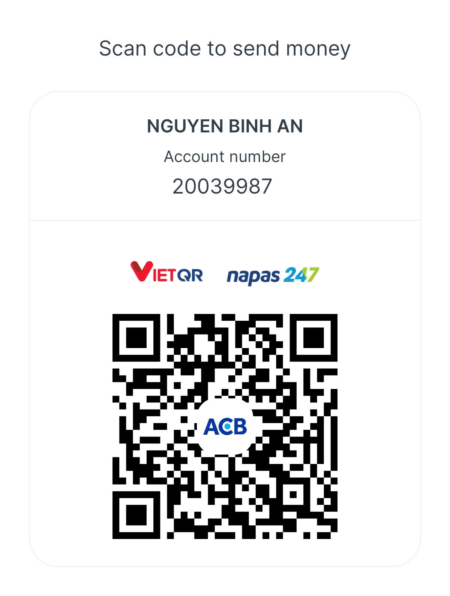

🇻🇳 Tiếng Việt | [🇬🇧 English](README.en.md)

# GMS Fix

App Android giúp **thông báo (FCM) không bị HyperOS chặn**: không bị mất tin, không bị trễ, không bị ngắt kết nối. Viết cho Xiaomi chạy **HyperOS ROM CN** và **không root**.

- Package: `com.anb.gmsfix` · versionName 3.0.x · minSdk 24 · targetSdk 35
- Máy thử nghiệm: Xiaomi `popsicle` (2509FPN0BC), HyperOS OS4.0 CN, Android 17, không root
- Ràng buộc: bình thường **Developer options phải tắt** (để app ngân hàng và VNeID chạy được). Shizuku chỉ bật khi cần bấm **Fix ngay**.

- Ngôn ngữ: app có **Tiếng Việt / English / theo hệ thống**, chọn ngôn ngữ trong app.

> ☕ App giúp được bạn? [Mời mình ly cà phê](#-mời-mình-ly-cà-phê) nha!

---

## Chuẩn bị (lần đầu trên máy mới)

Làm 1 lần. Sau đó Developer options tắt lại được, app vẫn chạy.

**1. Cài app**
Tải `GmsFix-3.0.3.apk` ở [Releases](https://github.com/justBA/GmsFix/releases/latest) rồi cài. Lần mở đầu tiên, cho phép **Thông báo** (cảnh báo mất/trễ tin cần quyền này).

**2. Bật Developer options**
*Cài đặt → Giới thiệu điện thoại* → chạm **Phiên bản OS** 7 lần. Sau đó vào *Cài đặt → Cài đặt bổ sung → Tùy chọn nhà phát triển*, bật:
- **USB debugging** (Gỡ lỗi USB)
- **Install via USB** (Cài đặt qua USB)
- **USB debugging (Security settings)**: Xiaomi bắt buộc mục này thì mới cấp được `WRITE_SECURE_SETTINGS`. Mục này thường đòi đăng nhập Mi account và có SIM.
- **Wireless debugging** (Gỡ lỗi không dây), nếu dùng Shizuku không cần máy tính.

**3. Cài và khởi động Shizuku**
- Tải Shizuku, chọn 1 trong 2 (máy thử dùng 13.6.0):
  - **Google Play**: [Shizuku trên Google Play](https://play.google.com/store/apps/details?id=moe.shizuku.privileged.api) — tự cập nhật. ROM CN thường chưa có Google Play Store; có thì dùng cách này.
  - **GitHub**: [RikkaApps/Shizuku/releases](https://github.com/RikkaApps/Shizuku/releases) → tải file `.apk` mới nhất ở mục *Assets* rồi cài (cho phép "Cài ứng dụng không rõ nguồn gốc" nếu được hỏi).
  - Nút *Tải Shizuku* trong GMS Fix mở Google Play nếu máy có, không thì mở GitHub.
- **Ghép nối Shizuku qua Wireless debugging (làm 1 lần, không cần máy tính):**
  1. Kết nối **Wi-Fi** (mạng nào cũng được, không cần internet).
  2. Cho phép **thông báo** của Shizuku: mã ghép nối được nhập ngay trong thông báo của nó.
  3. *Cài đặt → Cài đặt bổ sung → Tùy chọn nhà phát triển* → bật **Wireless debugging (Gỡ lỗi không dây)**. Hỏi "Cho phép gỡ lỗi không dây trên mạng này?" thì chọn **Cho phép** (tick "Luôn cho phép trên mạng này" để lần sau khỏi hỏi).
  4. Mở Shizuku → mục *Start via Wireless debugging* → bấm **Pairing**. Shizuku hiện một thông báo "Đang tìm dịch vụ ghép nối…".
  5. Quay lại *Wireless debugging* → bấm **Pair device with pairing code (Ghép nối thiết bị bằng mã)**. Màn hình hiện **mã 6 số**. Đừng tắt hộp thoại này.
  6. Kéo thanh thông báo xuống → thông báo của Shizuku → **Enter pairing code** → nhập 6 số → gửi. Thấy "Ghép nối thành công" là xong. Trong *Wireless debugging* sẽ có thiết bị "Shizuku" ở mục *Paired devices*.
  7. Quay lại Shizuku → bấm **Start**. Dòng trạng thái đổi thành *Shizuku is running*.
  - Không thấy thông báo để nhập mã: kiểm tra lại quyền thông báo của Shizuku, hoặc chia đôi màn hình (Shizuku + Cài đặt) rồi làm lại bước 4–6.
  - Từ lần sau **không cần ghép nối lại**: chỉ cần Wi-Fi + Wireless debugging bật rồi bấm Start. GMS Fix tự bật Wireless debugging và mở Shizuku khi bạn bấm Fix ngay.
- Nếu có máy tính, có thể khởi động Shizuku bằng cáp, chạy lệnh mà Shizuku hiện ở mục *Start via adb*, ví dụ:
  ```bash
  adb shell 'sh -c "$(pm path moe.shizuku.privileged.api | cut -d: -f2 | sed s/base.apk//)lib/arm64/libshizuku.so"'
  ```
- **Wireless debugging chỉ bật được khi máy đang kết nối Wi-Fi** (không cần internet). Không có Wi-Fi thì phát hotspot từ máy khác rồi kết nối vào, hoặc dùng cáp + lệnh adb ở trên. Shizuku chạy rồi thì ngắt Wi-Fi không sao. Fix ngay sẽ báo nếu thiếu Wi-Fi thay vì kẹt ở bước mở Shizuku.
- Shizuku **dừng** khi khởi động lại máy hoặc khi tắt Wireless debugging / Developer options. Lần sau bấm Fix, app tự bật Developer, mở Shizuku để bạn bấm Start rồi chạy tiếp.

**4. Bấm *Fix ngay* trong GMS Fix**
- Bấm dấu **ⓘ cạnh chữ Trạng thái** để xem checklist điều kiện (app cần có, Shizuku, từng quyền của GMS Fix). Mục chưa đạt có dấu ! — bấm vào để xem hướng dẫn và mở thẳng trang cài đặt / xin quyền / trang tải. *Fix ngay* chỉ chạy khi đủ điều kiện bắt buộc, thiếu gì sẽ hướng dẫn mục đó thay vì chạy dở.
- Shizuku hỏi quyền cho GMS Fix → **Allow**. Trên HyperOS 4 CN, Shizuku không lưu "Allow all the time", nên mỗi lần Fix có thể phải bấm Allow lại.
- Bước *Cấp quyền cho GMS Fix* của Fix tự cấp các quyền sau. Nếu không dùng Shizuku, chạy bằng adb từ máy tính cũng được:
  ```bash
  adb shell pm grant com.anb.gmsfix android.permission.WRITE_SECURE_SETTINGS
  adb shell pm grant com.anb.gmsfix android.permission.DUMP
  adb shell pm grant com.anb.gmsfix android.permission.PACKAGE_USAGE_STATS
  adb shell cmd appops set com.anb.gmsfix GET_USAGE_STATS allow
  adb shell cmd appops set com.anb.gmsfix SCHEDULE_EXACT_ALARM allow
  ```
  | Quyền | Để làm gì |
  |---|---|
  | `WRITE_SECURE_SETTINGS` | Ghi `aurogon_enable`, `device_idle_constants`, Nighttime mode; tự bật/tắt Developer options |
  | `DUMP` | Đọc trạng thái FCM, Greezer, doze; áp dụng lại phần Greezer sau khi khởi động máy |
  | `PACKAGE_USAGE_STATS` + `GET_USAGE_STATS` | Đọc `dumpsys GcmService` không cần Shizuku |
  | `SCHEDULE_EXACT_ALARM` | Báo thức "Đánh thức GMS" đúng giờ |

**5. Quyền trong HyperOS cho chính GMS Fix**
- *Cài đặt → Ứng dụng → GMS Fix → Quyền khác* → bật **Đọc danh sách ứng dụng đã cài**. App cũng tự hỏi khi bấm chọn ứng dụng. Thiếu quyền này thì danh sách chỉ thấy app hệ thống.
- Bật **Tự khởi chạy** (Autostart) và để cài đặt pin là **No restrictions** cho GMS Fix.

**6. Chọn app và thói quen nên có**
- Thêm app chat, ngân hàng… vào danh sách, rồi bấm **Fix ngay** lại.
- **Khoá** app quan trọng trong đa nhiệm (nhấn giữ thẻ → ổ khoá). Đừng vuốt bỏ hay "dọn tất cả": trên ROM này đó là force-stop.
- Nighttime mode: app tự tắt (tuỳ chọn *Ban đêm*, mặc định bật).

**7. Tắt Developer options lại**
Xong thì tắt bằng nút trong app (mặc định Fix xong app tự tắt), để app ngân hàng và VNeID chạy được.

Khi Developer options tắt và Shizuku không chạy, **vẫn hoạt động**: đánh thức GMS định kỳ, `aurogon_enable` (FCM mở băng app), nới deep doze, giữ Nighttime mode tắt, cảnh báo, áp dụng lại sau khi khởi động máy. **Cần Shizuku (bấm Fix):** No Restrictions cho Google Play services sau khi khởi động lại, danh sách alarm ban đêm, bỏ trạng thái dừng, tự khởi chạy, Doze whitelist.

---

## Vì sao thông báo bị mất hoặc trễ trên HyperOS CN

| Nguyên nhân | Hậu quả |
|---|---|
| **Greezer** (bộ đóng băng của `miui-services`) đóng băng app nền, và đóng băng cả GMS (GMS nằm cứng trong `greezer_power_black_list`) | Mất kết nối FCM, tin tới app bị giữ lại |
| **Sleep mode / Nighttime mode** ban đêm (~01:00–05:30, khi phát hiện bạn ngủ): PowerKeeper **tắt 4G + Wi‑Fi** và Greezer đóng băng cả app trong No Restrictions | FCM mất kết nối hàng giờ, tin tới dồn lúc sáng. **Đã xử lý:** tắt *Pin → Additional features → Nighttime mode* (tuỳ chọn *Ban đêm* của app tự giữ nó tắt). Tắt xong thì Greezer cũng không vào sleep mode nữa, **không cần root** |
| **Deep doze rất gắt**: tắt màn hình là Quick Doze, ngủ sâu sau ~1 phút, khoảng thức gom tin 1 → 6 giờ | Tin ưu tiên thường bị máy chủ giữ lại tới 1–6 giờ |
| **Vuốt app khỏi đa nhiệm = force-stop** (`SwipeUpClean`, `OneKeyClean`, `GameClean`) | App bị dừng hẳn, GMS bỏ tin (`Failed to broadcast to stopped app`) cho tới khi mở lại app |
| **PowerKeeper** ghi đè `MILLET_NO_RESTRICT_APP` từ cài đặt pin mỗi khi khởi động lại hoặc đổi chế độ pin | Các thiết lập ghi bằng lệnh bị mất |
| Cờ ROM `cn.google.services` | GMS tắt một số tính năng: Timeline của Maps, Quick Share, Find Hub ngoại tuyến, chia sẻ vị trí… Không sửa được nếu không root |

---

## Tính năng

Màn hình chính có 2 hướng xử lý, mỗi hướng một màn hình riêng. **Hiện chỉ hướng 1 hoạt động**; hướng 2 (theme) chưa hoạt động.

### 1. Giữ FCM sống (dùng hằng ngày)

**Danh sách app, chia 2 mức** (bấm ⚡ để đổi mức; app này mở thẳng trang *Battery details* của app được chọn):

| | ⚡ cam **Luôn chạy nền** | ⚡ xám **Chỉ khi có tin** (mặc định) |
|---|---|---|
| Ví dụ | Google Play services, Zepp (đồng hồ) | Facebook, Messenger, Zalo, MoMo, ngân hàng… |
| Cài đặt pin (PowerKeeper) | **No restrictions** | **Battery saver (recommended)** |
| Greezer đóng băng khi rảnh | Không | Có (đỡ pin) |
| Có tin FCM thì được mở băng | ✅ | ✅ |
| Tự khởi chạy, bỏ trạng thái dừng, chạy nền, dữ liệu nền | ✅ | ✅ |
| Miễn Doze, low-latency, standby bucket "active" | ✅ | ❌ (tin ưu tiên cao vẫn được Android cho thức tạm) |

**Tuỳ chọn:**
- **Đánh thức GMS định kỳ** (5/10/15/20 phút): chỉ chạy khi dùng pin và tắt màn hình. App truy vấn provider của GMS để Greezer mở băng GMS, kiểm tra lại kết nối FCM, nếu hỏng thì thử lại sau 3 phút.
- **Cho FCM đánh thức app bị đóng băng** (mặc định bật): ghi mục `broadcastctrl:true#pkg/com.google.android.c2dm.intent.RECEIVE#…` vào Settings.Global `aurogon_enable`. Greezer chỉ mở băng app khi có tin FCM. Chế độ "mọi broadcast" (`broadcastctrl:false`) cũng có, nhưng tốn pin hơn.
  - **Tự ghi lại nếu bị đổi**: cloud hoặc HyperOS đổi lại thì app tự ghi lại.
  - **Mọi app có FCM** (mặc định bật): ngoài danh sách đã chọn, thêm mọi app có receiver c2dm. App mới cài tự được thêm. Bấm "xem ›" để xem danh sách.
- **Nới deep doze** (mặc định bật): Settings.Global `device_idle_constants`. Ngủ sâu sau 2 phút, thức gom tin mỗi 15 → 30 phút. Tin ưu tiên thường trễ tối đa ~30 phút, thay vì 1–6 giờ. Nút ⓘ cho xem giá trị đang dùng và giá trị mặc định của HyperOS.
- **Ban đêm (sleep mode)** (mặc định bật, đã kiểm chứng đêm 24→25/11):
  - Tắt **Nighttime mode**: Settings.Secure `sec_pc_config_scenario_policies_open = 0`. App ghi bằng quyền của nó (**không cần Shizuku**) và tự tắt lại mỗi lần đánh thức GMS hoặc khởi động máy nếu bị bật lại.
  - Thêm Google Play services + GMS Fix vào `cloud_aurogon_alarm_allow_list`, để alarm heartbeat/đánh thức được đi qua khi đang bị đóng băng. Phần này cần Shizuku. Kiểm tra cài đặt sẽ báo nếu bị đặt lại.

**Cảnh báo** (mỗi loại bật/tắt riêng, áp dụng cho app trong danh sách và mọi app có FCM):
- **Mất thông báo**: GMS bỏ tin vì app đang bị dừng.
- **Thông báo bị trễ**: tin ưu tiên cao trễ hơn 2 phút. Tin ưu tiên thường chỉ ghi vào log khi trễ hơn 35 phút.
- **Cài đặt bị đổi**: HyperOS đổi lại các quyền chạy nền.
- **App tắt thông báo** (mặc định tắt).
- Trang **Log** riêng, có lọc theo loại và ghi rõ tên app.

**Trạng thái:** kết nối FCM, thống kê 24 giờ, kiểm tra cài đặt, Shizuku, root, Developer options. Có widget hiển thị trạng thái FCM.
- **FCM 24 giờ qua** ghi dạng `Rớt 10 (2 lâu) • trễ 22 (0 đáng lo)`. Con số đầu là của GMS, đếm cả lần đổi Wi‑Fi ↔ 4G (rớt 0 giây) và tin ưu tiên cao trễ 1–2 giây, nên luôn lớn hơn log cảnh báo. Trong ngoặc là phần đáng chú ý: rớt quá 1 phút, tin ưu tiên cao trễ quá 2 phút, tin thường trễ quá 35 phút. Nhãn màu bên phải dựa trên phần này.
- **Log cảnh báo** ghi theo giờ máy. Giờ trong chẩn đoán của GMS là UTC, app tự đổi.

**Fix ngay** (cần Shizuku hoặc root). Các bước:
1. No Restrictions theo 2 mức
2. Tắt GMS freezer của Greezer (`dumpsys greezer IM GMS disable`) và allowlist LM
3. Low-latency
4. Doze whitelist (thêm cho app luôn chạy nền, gỡ cho app chỉ khi có tin)
5. Cho phép chạy nền
6. Dữ liệu nền
7. Standby bucket
8. Tự khởi chạy (MIUI appop 10008 + 10053, công tắc)
9. Cấp quyền cho GMS Fix (`WRITE_SECURE_SETTINGS`, `DUMP`, usage access, exact alarm)
10. **Bỏ trạng thái dừng** cho app trong danh sách và mọi app có FCM
11. Ban đêm (sleep mode), nếu bật
12. Kiểm tra lại

Xong thì app tự tắt Developer options, nếu tuỳ chọn đó đang bật.

**Sau khi khởi động lại máy:** app tự áp dụng lại phần Greezer (bằng quyền `DUMP`), `aurogon_enable`, doze và tắt Nighttime mode, **không cần Shizuku**. Riêng Google Play services bị PowerKeeper xoá khỏi No Restrictions, nên app sẽ nhắc bấm Fix.

### 2. Chỉnh bằng theme — ⚠️ CHƯA HOẠT ĐỘNG

Tạo file `.mtz` ẩn (`Download/GmsFix-FCM.mtz`) để ghi đè `theme_values.xml` của `android.miui`: bỏ GMS khỏi danh sách đen của Greezer, thêm app vào các whitelist. Có nút gỡ hoặc khôi phục app Themes (tuỳ chọn, có rollback).

**Chưa hoạt động, đừng dùng để thay cho mục 1.** Lý do: app Themes (cả bản CN 11.5.6 lẫn bản Global) kiểm tra DRM khi áp dụng theme (`DRM_ERROR_RIGHT_FILE_NOT_EXISTS`). Dự án này **không** vượt DRM.

---

## Những điều đã kiểm chứng trên máy

- `MILLET_NO_RESTRICT_APP` (Settings.System) **chỉ là bản sao** của cài đặt pin trong PowerKeeper. App thường không ghi được khoá này ("You cannot keep your settings in the secure settings"), phải dùng shell.
- Dữ liệu của PowerKeeper được bảo vệ bằng quyền `signature|privileged`, không đọc được. Trang *Battery details* mở được bằng `android.settings.REQUEST_IGNORE_BATTERY_OPTIMIZATIONS` + `package:<pkg>`.
- `device_config put device_idle …` bị Android 17 chặn, kể cả với shell. Settings.Global `device_idle_constants` thì **ghi được bằng quyền của app**, nhưng app không đọc lại được. Vì vậy app kiểm tra giá trị qua `dumpsys deviceidle`.
- Quick Doze bỏ qua `inactive_to` và motion. `quick_doze_delay_to` có tác dụng nhưng bị giới hạn ~2 phút. `idle_to`/`max_idle_to` có tác dụng.
- Shizuku 13.6 trên ROM này **không lưu** lựa chọn "Allow all the time", nên mỗi lần Fix có thể phải bấm Allow lại.
- Tự khởi chạy **không** cứu được app đã bị dừng hẳn, vì GMS tự bỏ tin trước. Nó chỉ cần cho app bị giết tiến trình nhưng không bị force-stop.
- MIUI appop `10053` là trạng thái công tắc Tự khởi chạy. Fix đặt cùng `10008`. Trước khi sửa, 24 app bị lệch (10008 cho phép, 10053 chặn).
- Exit-info của máy: **SwipeUpClean 202, OneKeyClean 145, GameClean 108** lần force-stop. Vuốt đóng app, "dọn tất cả" và Game Turbo đều force-stop thật.
- Sleep mode đêm 23→24/11: `SLEEP_MODE enter/exit` (01:15–03:54, 04:15–05:30) **khớp chính xác** với GMS `ERR_NET_DOWN`. Nguyên nhân: **PowerKeeper tắt dữ liệu di động** (`Set user data enabled to false … callingPackage=com.miui.powerkeeper`) **và tắt Wi‑Fi** (`CMD_WIFI_TOGGLED`, WorkSource `com.miui.powerkeeper`), rồi bật lại khi ra sleep mode. Tuỳ chọn trong giao diện: *Pin → Additional features → Nighttime mode* = Settings.Secure `sec_pc_config_scenario_policies_open`. Sleep mode cũng đóng băng chính GMS Fix, nên "Đánh thức GMS" gần như không chạy được cả đêm.
- `cloud_sleepmode_networkpolicy_enabled` **không** phải thứ cắt mạng. Theo mã ROM (`MiuiNetworkPolicyManagerService.sleepModeEnableControl`), nhánh đó chỉ bật khi giá trị là `"on"` **và** `key_open_earthquake_warning == 1`, mà trên máy là 0. Danh sách `mSleepModeWhitelistUids` (thêm qua `IMiuiNetworkManager.onSleepModeWhitelistChange`, mã giao dịch 5) thuộc nhánh này, nên cũng không có tác dụng.
- Broadcast heartbeat (`GTALK_HEARTBEAT`, `MCS_HEARTBEAT`) **không ổn định**: một lần trùng với heartbeat, thử lại 3 lần không có tác dụng. Không dùng.
- Tin của app chat bị cập nhật im lặng (Zalo gộp tin trong ~10 giây, KChat `onlyAlertOnce`, Instagram `groupAlertBehavior=SUMMARY`) là do app, không phải do máy.

---

### Tự kiểm tra mất mạng ban đêm trên máy khác

Sáng hôm sau, cắm adb rồi chạy:

```bash
# PowerKeeper có tắt Wi‑Fi không (dòng CMD_WIFI_TOGGLED ... WorkSource{1000 com.miui.powerkeeper})
adb shell dumpsys wifi | grep -E "CMD_WIFI_TOGGLED.*powerkeeper"
# PowerKeeper có tắt dữ liệu di động không
adb shell dumpsys activity service com.android.phone | grep -E "user data enabled.*powerkeeper"
# Giờ vào/ra sleep mode của Greezer
adb shell dumpsys greezer | grep "SLEEP_MODE"
# GMS mất mạng lúc nào, bao lâu
adb shell dumpsys activity service com.google.android.gms/.gcm.GcmService | grep -A2 "INCIDENT"
# Nighttime mode đang bật (1) hay tắt (0)
adb shell settings get secure sec_pc_config_scenario_policies_open
```

Nếu giờ Wi‑Fi/4G bị tắt khớp với `SLEEP_MODE: enter` và GMS báo `ERR_NET_DOWN`, thì đó là Nighttime mode.

---

## Đang thử nghiệm

| Thử nghiệm | Đã làm | Kết quả tới giờ | Trạng thái |
|---|---|---|---|
| **GMS + GMS Fix vào `cloud_aurogon_alarm_allow_list`** | Ghi bằng adb 23/11 lúc 23:2x (giữ 3 mục mặc định của ROM). Ngày 24/11 đưa vào app | ✅ **Có tác dụng**: 05:20 ngày 24/11, GMS được mở băng với lý do `alarm`, lần đầu tiên thấy (trước đó 0 lần). Sau khi tắt Nighttime mode thì GMS không còn bị đóng băng ban đêm, nên danh sách này giờ là lớp dự phòng | Đã vào app (tuỳ chọn *Ban đêm*) |
| **Tắt Nighttime mode** (`sec_pc_config_scenario_policies_open = 0`) | Tắt trong giao diện 24/11 lúc 06:2x. App tự giữ (đã thử: bật lại bằng adb thì app tự tắt) | ✅ **Đêm 24→25/11:** PowerKeeper không tắt 4G/Wi‑Fi lần nào, Greezer **không vào `SLEEP_MODE`**, FCM **không rớt** từ 15:00 tới 06:00, GMS bị đóng băng **0 giây**, "Đánh thức GMS" 117/118 lần OK, không tin ưu tiên cao nào bị trễ. So với đêm 23→24: mất mạng 2 giờ 39 phút + 71 phút, Zalo trễ 36 phút | Đã vào app (tuỳ chọn *Ban đêm*) |
| `cloud_sleepmode_networkpolicy_enabled=off` | Ghi bằng adb 24/11 lúc 05:5x | ❌ Không liên quan (nhánh cần cảnh báo động đất bật). Đã trả về `on` | Bỏ |
| Danh sách giữ mạng khi sleep mode (`mSleepModeWhitelistUids`) | Đọc mã ROM: thêm qua `IMiuiNetworkManager.onSleepModeWhitelistChange`, mã giao dịch 5 | ❌ Thuộc nhánh NetworkPolicy đang không chạy (cần `key_open_earthquake_warning=1`). Thêm vào cũng không giúp, có khi còn bật nhánh giới hạn mạng cho app khác | Bỏ |
| Chia 2 mức + "Mọi app có FCM" | Đưa vào app 23/11 | ✅ Messenger và Facebook bắt đầu bị đóng băng (trước đây 0 giây) mà vẫn nhận tin FCM. Danh sách mở băng có 116 app (~7 KB trong `aurogon_enable`) | ⏳ Chưa xác nhận Greezer đọc đủ 116 app: cần thấy app ngoài 34 app được mở băng `reason : broadcast` khi có tin |
| Theme `.mtz` sửa danh sách của ROM | Tạo được file | ❌ App Themes kiểm tra DRM | Dừng, không vượt DRM |

---

## Khuyến nghị khi dùng

- **Tắt Nighttime mode**: *Cài đặt → Pin → Additional features → Nighttime mode*. Tuỳ chọn này tắt 4G và Wi‑Fi khi máy phát hiện bạn ngủ, nên mọi thông báo ban đêm đều tới trễ tới sáng. Tuỳ chọn *Ban đêm* của app tự giữ nó tắt. Đổi lại pin ban đêm tốn hơn.
- **Đừng vuốt app chat hoặc ngân hàng khỏi đa nhiệm**, đừng bấm "dọn tất cả". Trên ROM này hai thao tác đó là force-stop. Có thể khoá app trong đa nhiệm.
- Thấy cảnh báo **Mất thông báo** thì mở app đó lên một lần, hoặc bấm **Fix ngay**.
- App ở mức "Chỉ khi có tin" thì để cài đặt pin là **Battery saver (recommended)**. Nếu không, PowerKeeper sẽ thêm lại app vào No Restrictions.

---

## Build và cài đặt

```bash
./gradlew assembleDebug
adb install -r app/build/outputs/apk/debug/app-debug.apk
```

- APK được ký bằng debug key của máy build. Cài đè từ máy khác sẽ lỗi chữ ký, phải gỡ app trước.
- Lần đầu cần chạy **Fix ngay** với Shizuku (hoặc root) để app được cấp quyền, xem [Chuẩn bị](#chuẩn-bị-lần-đầu-trên-máy-mới).

## Cấu trúc mã nguồn

| File | Vai trò |
|---|---|
| `HomeActivity` | Màn hình chính, chọn 1 trong 2 tính năng |
| `MainActivity` | Màn hình "Giữ FCM sống": trạng thái, danh sách app, tuỳ chọn, cảnh báo, Fix |
| `Steps` | Các bước shell của Fix |
| `Shell` | Chạy lệnh trực tiếp, qua Shizuku hoặc root |
| `NoRestrictGuard` | 2 mức, `MILLET_NO_RESTRICT_APP`, mở trang cài đặt pin |
| `BroadcastCtrl` | `aurogon_enable` / `broadcastctrl`, danh sách mọi app có FCM |
| `DozeTune` | `device_idle_constants` (nới deep doze) |
| `SleepGuard` | Ban đêm: Nighttime mode (`sec_pc_config_scenario_policies_open`), `cloud_aurogon_alarm_allow_list` |
| `KeepAlive` | Báo thức đánh thức GMS định kỳ, tự áp dụng lại cài đặt |
| `BootReceiver` | Áp dụng lại sau khi khởi động máy |
| `FcmStatus` | Đọc `dumpsys GcmService`: kết nối, thống kê 24 giờ |
| `HealthCheck` | Kiểm tra cài đặt từng app |
| `AlertCenter`, `AlertLogActivity` | Cảnh báo và trang log |
| `AppGroups`, `AppPicker` | Nhóm app, chọn app |
| `ThemeFix`, `ThemeActivity` | Tạo theme `.mtz` |
| `FcmWidget` | Widget trạng thái FCM |

## Rollback

Dự án dùng git local. Mỗi tính năng là một commit:

```bash
git log --oneline          # xem các mốc
git checkout <commit> -- . # lấy lại mã nguồn ở một mốc
./gradlew assembleDebug && adb install -r app/build/outputs/apk/debug/app-debug.apk
```

Mốc `cd2e715` là bản ổn định trước khi chia 2 mức.

---

## ☕ Mời mình ly cà phê

Nếu GMS Fix giúp bạn không còn lỡ tin nhắn, có thể mời mình ly cà phê để mình có động lực làm tiếp 🙏

<p align="center">
  
</p>

| Ngân hàng | Chủ tài khoản | Số tài khoản |
|---|---|---|
| **ACB** | NGUYEN BINH AN | `20039987` |

Quét QR bằng app ngân hàng bất kỳ (VietQR / Napas 247). Cảm ơn bạn rất nhiều! ❤️
